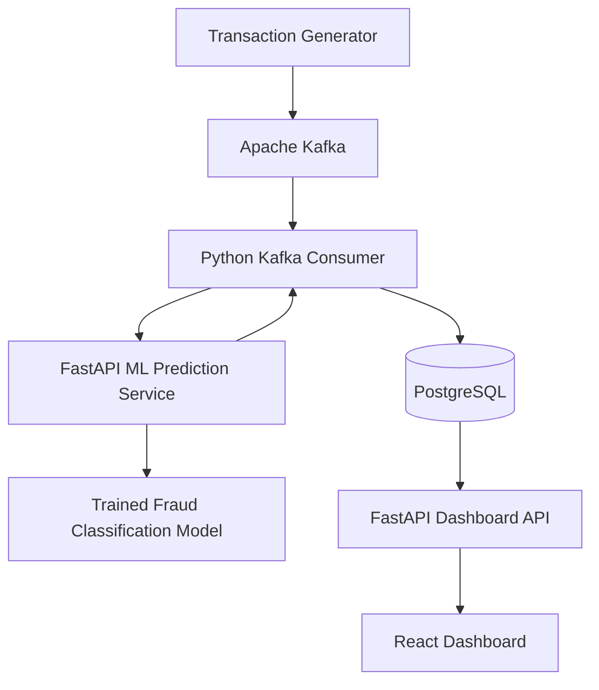

# Real-Time Fraud Detection Platform

A streaming fraud detection application that processes credit-card transactions through Apache Kafka, scores them using a machine learning model, stores predictions in PostgreSQL, and displays results in a live React dashboard.

## Overview

This project demonstrates an end-to-end data and machine learning pipeline, from transaction ingestion to fraud prediction, persistence, and visualization.

### Architecture



## Features

- **Streaming ingestion:** Publish transaction events to Apache Kafka.
- **Machine learning inference:** Score transactions using a trained classification model served through FastAPI.
- **Persistent storage:** Store transaction IDs, actual labels for offline evaluation, predictions, fraud scores, and decision thresholds in PostgreSQL.
- **Live dashboard:** View transaction activity, fraud detection metrics, missed frauds, and false positives.
- **Automated refresh:** Update dashboard data periodically without manual page reloads.
- **One-command startup:** Launch the application using `./start.sh`.
- **Simple shutdown:** Stop application processes using `./stop.sh`.

## Technology Stack

| Component | Technologies |
|---|---|
| Machine learning | Python, pandas, scikit-learn, HistGradientBoostingClassifier |
| Model serving | FastAPI, Uvicorn |
| Event streaming | Apache Kafka |
| Database | PostgreSQL |
| Frontend | React, Vite, JavaScript, CSS |
| Infrastructure | Docker, Docker Compose |
| API communication | REST, JSON |

## How It Works

1. The transaction generator selects sample records from the credit-card dataset and publishes them to Kafka.
2. The Kafka consumer reads incoming events and sends the model features to the prediction API.
3. The model returns a prediction, fraud score, and configured decision threshold.
4. The consumer stores the prediction in PostgreSQL and commits the Kafka offset after the database write.
5. The Dashboard API queries the database and exposes transaction records and aggregate statistics.
6. The React frontend periodically fetches updated records and metrics.

## Model Evaluation

The model was evaluated on a chronological holdout test set to better reflect evaluation on later transactions.

| Metric | Test result |
|---|---:|
| Precision (fraud class) | 0.8182 |
| Recall (fraud class) | 0.6923 |
| F1 score (fraud class) | 0.7500 |
| Average precision | 0.7295 |
| True positives | 36 |
| False negatives | 16 |
| False positives | 8 |
| True negatives | 42,662 |

The decision threshold was selected using validation data and set to approximately `0.91`.

**Interpretation:** On the held-out test set, the model detected 36 of 52 fraudulent transactions, with 8 legitimate transactions incorrectly flagged. Fraud detection involves a trade-off between catching more fraud and limiting false alarms.

The model's fraud score is a model output and should not automatically be interpreted as a calibrated probability.

## Getting Started

### Prerequisites

- macOS or Linux
- Docker Desktop with Docker Compose
- Python and the project's Python virtual environment
- Node.js and npm
- The credit-card dataset described below

### 1. Obtain the dataset

Download the `creditcard.csv` file from the [Credit Card Fraud Detection dataset on Kaggle](https://www.kaggle.com/datasets/mlg-ulb/creditcardfraud).

Place it at:

```text
ml-service/data/creditcard.csv
```

The dataset is not included in this repository because of its size. Follow the dataset provider's terms when downloading and using it.

### 2. Install Python dependencies

Create and activate the virtual environment if you do not already have one:

```bash
python3 -m venv ml-service/.venv
source ml-service/.venv/bin/activate
```

Install the Python packages used by the application. If a `requirements.txt` file is present:

```bash
pip install -r ml-service/requirements.txt
```

If your dependency file is stored elsewhere, use its actual path.

The trained model and threshold files must be present under `ml-service/models/`. If they are not included in your checkout, train the model using the project's training script after downloading the dataset:

```bash
python ml-service/src/train_model.py
```

### 3. Install frontend dependencies

```bash
cd dashboard
npm install
cd ..
```

### 4. Start the application

From the repository root:

```bash
./start.sh
```

The launcher starts Docker services, the ML API, the Dashboard API, the Kafka consumer, the React dashboard, and the sample transaction generator.

Open the dashboard:

**http://localhost:5173/**

### 5. Stop the application

```bash
./stop.sh
```

The stop script leaves Kafka and PostgreSQL containers running. To stop those containers too:

```bash
docker compose stop
```

## API Endpoints

### ML Prediction API — port 8000

- `GET /health` — health check
- `POST /predict` — score a transaction

Interactive API documentation: http://127.0.0.1:8000/docs

### Dashboard API — port 8001

- `GET /health` — health check
- `GET /transactions?limit=100` — retrieve recent transactions
- `GET /stats` — retrieve aggregate fraud metrics

Interactive API documentation: http://127.0.0.1:8001/docs

## Project Structure

```text
fraud-detection-platform/
├── dashboard/                 # React frontend
├── ml-service/
│   ├── data/                  # Downloaded dataset (not committed)
│   ├── models/                # Trained model and threshold
│   └── src/
│       ├── train_model.py     # Model training and evaluation
│       ├── app.py             # ML prediction API
│       ├── producer.py        # Original test producer
│       ├── consumer.py        # Original test consumer
│       ├── live_producer.py   # Continuous sample event generator
│       ├── live_consumer.py   # Kafka-to-ML-to-PostgreSQL processing
│       └── dashboard_api.py   # Dashboard REST API
├── docker-compose.yml
├── start.sh
├── stop.sh
└── README.md
```

## Limitations and Future Improvements

- The live demo deliberately oversamples fraudulent examples to make detections visible; its event mix is not representative of real-world fraud prevalence.
- The dataset contains historical transactions and should not be treated as a production payment feed.
- Kafka offset commits and PostgreSQL inserts are not one atomic transaction; retries can produce duplicate rows.
- The demo uses local development configuration and is not hardened for production security, availability, or throughput.
- Further work could include idempotent database writes, automated tests, metrics and alerting, model calibration, drift monitoring, and deployment to a cloud environment.

## License and Data

Add an appropriate software license before accepting reuse of this repository. The dataset is distributed separately by its provider and remains subject to the provider's terms.
